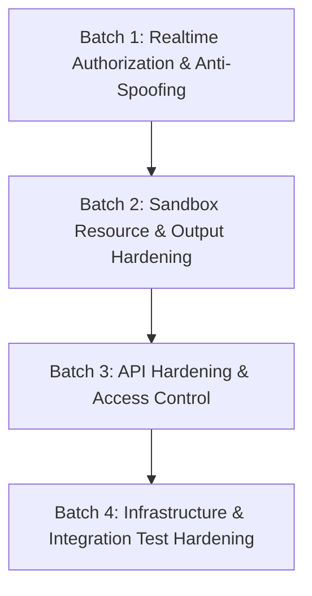

# CodeCollab Security Audit Report (M0.9)

**Date:** October 11, 2026  
**Auditor:** Antigravity AI Security Pair Programmer  
**Branch:** `feature/security-hardening`  
**Scope:** Full-stack source audit of Authentication, Realtime Authorization, Docker Execution Sandbox, API & Infrastructure Configuration, and Verification Quality.  
**Mode:** Audit-only (No application changes made in this phase).

---

## A. Executive Summary

CodeCollab has established a solid architectural foundation with several genuine defensive controls implemented in milestones M0.5 through M0.8. These include:
- Ephemeral Docker execution containers running as a non-privileged `sandbox` user with memory, swap, PID, and CPU limits.
- Network isolation disabled (`NetworkMode: 'none'`) during code execution.
- Bcrypt password hashing (`saltRounds = 10`) without plaintext persistence.
- JWT-based authentication for HTTP routes and initial Socket.IO connection handshakes.
- Driver-only authorization for collaborative editor alterations (`editor:change`) and code execution triggers (`POST /api/execute`).
- Real-time room isolation gates for editor synchronization and room member lists.

However, a thorough evidence-based audit of the live codebase reveals **critical and high-severity security exposures** that prevent the application from being considered secure or safe for public exposure:

1. **Realtime Cross-Room Message Injection & User Spoofing (`SEC-CHAT-01`, `SEC-REALTIME-02`):**  
   The real-time chat, presence, and typing subsystems (`chat.js`, `presence.js`, `typing.js`) perform **zero room membership checks** and **zero user identity verification**. Any connected Socket.IO client can emit events into any arbitrary room ID, forging the sender name, user ID, and message contents.

2. **Unbounded Execution Memory and Timeout Overrides (`SEC-EXEC-01`):**  
   While `sandboxConfig.js` declares conservative limits (5s timeout, 256MB memory), `executionService.js` and `executeCode.js` accept client-supplied `timeout` and `memory` parameters without any upper bound, allowing callers to spawn containers with arbitrary multi-gigabyte memory allocations and multi-hour execution limits.

3. **Unbounded Stdout/Stderr Buffer Memory Consumption (`SEC-EXEC-02`):**  
   The Dockerode output streams in `executor.js` buffer stdout and stderr strings indefinitely without a maximum size cap. A simple looping print statement inside user code can stream hundreds of megabytes of text into the Node.js process heap, triggering an Out-Of-Memory (OOM) crash of the entire backend.

4. **Missing Container Hardening Options (`SEC-EXEC-03`):**  
   Runner containers are created without `ReadonlyRootfs: true`, without dropping Linux capabilities (`CapDrop: ['ALL']`), and without `no-new-privileges:true`. Inside the container, user code runs as user `sandbox`, who owns `/app/runner.py` and `/app` with full write permissions.

5. **Test Hook Leaking into Production Logic & Soft Authorization Fallback (`SEC-ROOM-01`):**  
   `realtime/server/rooms.js` inspects `Room.findOne.mock` (a Jest test artifact) to determine whether the database is configured. If database environment variables are omitted in non-production environments, room authorization fails open rather than failing closed, permitting unauthenticated socket joins.

6. **Infrastructure Exposure & Hardcoded Secrets (`SEC-INFRA-01`):**  
   `docker-compose.yml` hardcodes `JWT_SECRET=dev_secret_key_12345` and exposes MongoDB (port 27017) and Redis (port 6379) directly to host network interfaces without passwords. Furthermore, `backend/Dockerfile` and `frontend/Dockerfile` do not exist, making `docker-compose up` unrunnable.

7. **Private Room Bypass (`SEC-ROOM-02`):**  
   The room model defines `isPrivate: Boolean`, but `joinRoom` in `roomService.js` ignores this flag entirely, allowing any authenticated user who discovers or guesses a room slug to join without authorization.

The current implementation is **suitable for controlled local development only**. It is **not ready for invite-only staging or public deployment** until the prioritized remediation batches below are implemented and verified.

---

## B. Findings Table

The table below catalogs all findings identified during source inspection. Findings are categorized into **Confirmed Vulnerabilities** (reproducible logic/configuration flaws verified in code) and **Potential Risks / Architectural Gaps** (configuration deficiencies or unmitigated edge cases).

| ID | Severity | Category | Component | File Path & Lines | Realistic Scenario | Recommended Mitigation | Tests Needed | Status |
| :--- | :--- | :--- | :--- | :--- | :--- | :--- | :--- | :--- |
| **SEC-CHAT-01** | **High** | Confirmed Vulnerability | Realtime Chat | [`realtime/server/chat.js`](file:///d:/AWT_CodeCollab/realtime/server/chat.js) | Any connected socket emits `chat:message_send` with a foreign `roomId` and spoofed `message.user`. Cross-room members receive malicious or spoofed messages. | Require socket room membership check (`socket.rooms.has(roomId)`). Bind sender metadata strictly to `socket.data.roomVerifiedUsers` or verified JWT. Limit message text length. | Integration test asserting non-member socket cannot emit chat into a room; test asserting spoofed client payload is replaced with verified identity. | **RESOLVED (Batch 1)** |
| **SEC-REALTIME-02** | **Medium** | Confirmed Vulnerability | Realtime Presence & Typing | [`realtime/server/presence.js`](file:///d:/AWT_CodeCollab/realtime/server/presence.js), [`realtime/server/typing.js`](file:///d:/AWT_CodeCollab/realtime/server/typing.js) | Attacker emits `typing:start` or `presence:status` with arbitrary `roomId` and fake user identity, injecting phantom activity into foreign rooms. | Verify room membership before relaying; extract user identity from verified socket session instead of client payload. | Test rejecting unjoined socket typing/presence emissions. | **RESOLVED (Batch 1)** |
| **SEC-ROOM-01** | **High** | Confirmed Vulnerability | Realtime Room Authorization | [`realtime/server/rooms.js`](file:///d:/AWT_CodeCollab/realtime/server/rooms.js) | In environments where `MONGO_URI` is unset and `NODE_ENV !== 'production'`, `isDbConfigured` evaluates to `false`. Database authorization is skipped entirely, admitting unauthenticated sockets with spoofed display names. Leaks test mock check `Room.findOne.mock`. | Remove test mock condition `Room.findOne.mock`. Default to strict fail-closed authorization. Reject unauthenticated joins unconditionally. | Test running `room:join` with DB disconnected / unset in non-production; verify connection is rejected with 401/403 rather than admitted. | **RESOLVED (Batch 1)** |
| **SEC-EXEC-01** | **High** | Confirmed Vulnerability | Execution Engine / Sandbox | [`backend/src/services/executionService.js:119-129`](file:///d:/AWT_CodeCollab/backend/src/services/executionService.js#L119-L129), [`execution/engine/executeCode.js:19`](file:///d:/AWT_CodeCollab/execution/engine/executeCode.js#L19), [`execution/engine/executor.js:84, 101-102`](file:///d:/AWT_CodeCollab/execution/engine/executor.js#L84-L102) | A malicious driver passes `{ timeout: 3600000, memory: "32g" }`. Container runs with 32GB RAM and 1-hour timeout, exhausting host memory and tying up runner concurrency. | Impose strict hard upper bounds: clamp `timeout` (max 10000ms) and `memory` (max 256m or 512m). Disallow unbounded client overrides. | Unit tests validating that requests exceeding limits are clamped or rejected with HTTP 400. | **RESOLVED (Batch 2)** |
| **SEC-EXEC-02** | **High** | Confirmed Vulnerability | Execution Engine / Memory | [`execution/engine/executor.js:119-129`](file:///d:/AWT_CodeCollab/execution/engine/executor.js#L119-L129) | Submitted Python code executes `while True: print("A"*100000)`. Docker demuxed stream concatenates hundreds of megabytes into Node.js memory buffer, crashing the backend with process OOM. | Impose a hard buffer cap (e.g., 64KB or 128KB). When reached, truncate, set a truncation flag, destroy streams, and terminate container. | Test running high-output Python script; verify output string length is capped at limit and backend memory remains flat. | **RESOLVED (Batch 2)** |
| **SEC-EXEC-03** | **High** | Potential Risk | Execution Engine / Sandbox | [`execution/engine/executor.js:100-106`](file:///d:/AWT_CodeCollab/execution/engine/executor.js#L100-L106), [`execution/runners/python/Dockerfile:8-17`](file:///d:/AWT_CodeCollab/execution/runners/python/Dockerfile#L8-L17) | Container root filesystem is writable (`ReadonlyRootfs` omitted); Linux capabilities not dropped (`CapDrop: ['ALL']` omitted); `no-new-privileges` omitted. Inside container, user `sandbox` owns and can write to `/app/runner.py`. | Add `ReadonlyRootfs: true`, mount `Tmpfs: { '/tmp': 'rw,noexec,nosuid,size=32m' }`, add `CapDrop: ['ALL']`, add `SecurityOpt: ['no-new-privileges:true']`, and make `/app` read-only (`chmod -R 555 /app`). | Verify container configuration via Dockerode inspections in unit test. | **RESOLVED (Batch 2)** |
| **SEC-EXEC-04** | **Medium** | Confirmed Vulnerability | Execution Engine / Validation | [`backend/src/services/executionService.js:115-117`](file:///d:/AWT_CodeCollab/backend/src/services/executionService.js#L115-L117), [`execution/engine/executor.js:95`](file:///d:/AWT_CodeCollab/execution/engine/executor.js#L95) | User submits code > 2MB. Linux `ARG_MAX` causes `docker.createContainer` with `Cmd: ['--code', code]` to fail with `E2BIG`. Huge string payloads also overload WebSocket sync. | Validate `code.length <= 65536` (64KB max) in `executionService.js` and `editorSync.js`. Pass code via stdin or mounted file if larger inputs are required. | Test submitting 100KB code string returning HTTP 400 validation error. | **RESOLVED (Batch 2)** |
| **SEC-EXEC-05** | **Medium** | Potential Risk | Execution Queue / Redis | [`execution/engine/queue.js:157-180`](file:///d:/AWT_CodeCollab/execution/engine/queue.js#L157-L180) | Attacker floods `/api/execute`. BullMQ queue has no backlog limit, storing thousands of jobs in Redis memory and stalling execution for all users. | Check `await queue.getWaitingCount()` before enqueueing. If backlog exceeds 25 jobs, reject with HTTP 429/503 "Execution queue is at capacity". | Test verifying queue rejection when backlog limit is reached. | **RESOLVED (Batch 2)** |
| **SEC-AUTH-01** | **Medium** | Potential Risk | Backend / Auth Config | [`backend/src/middleware/auth.js:3-12`](file:///d:/AWT_CodeCollab/backend/src/middleware/auth.js#L3-L12), [`infrastructure/docker-compose.yml:14`](file:///d:/AWT_CodeCollab/infrastructure/docker-compose.yml#L14) | Fallback secret `'dev_secret_key_12345'` is used whenever `NODE_ENV !== 'production'`. In `docker-compose.yml`, this dev secret is hardcoded directly. Any attacker can forge valid admin JWTs. | Reject startup if `JWT_SECRET` is unset or matches known default keys in staging/production. Do not hardcode secret in compose file. | Test that backend throws on startup if `JWT_SECRET` is unset or matches insecure default in non-local environments. | **RESOLVED (Batch 4)** |
| **SEC-AUTH-02** | **Low** | Confirmed Vulnerability | Backend / Auth Service | [`backend/src/services/authService.js:61-69, 128-138`](file:///d:/AWT_CodeCollab/backend/src/services/authService.js#L61-L69) | Registration explicitly states whether "Username is already taken" vs "An account with this email already exists". Login has measurable timing discrepancy (fast on missing user, slow bcrypt on existing user). | Unify registration duplicate error message ("Username or email is already registered"). Perform dummy bcrypt comparison on invalid user lookups to mitigate timing attacks. | Benchmark response latency on existing vs non-existing user login. | **RESOLVED (Batch 3)** |
| **SEC-AUTH-03** | **Medium** | Confirmed Vulnerability | Backend / Driver Auth | [`backend/src/services/executionService.js`](file:///d:/AWT_CodeCollab/backend/src/services/executionService.js) | `verifyDriverPermission` passes if `nameMatch` is true (`driverUsername === reqUsername`), even if `idMatch` is false. User display names are mutable or not guaranteed unique across scopes. | Restrict authorization strictly to immutable user IDs (`idMatch`). Remove `nameMatch` fallback entirely. | Test where driver user ID differs from request user ID but username matches; verify access is denied with HTTP 403. | **RESOLVED (Batch 1)** |
| **SEC-ROOM-02** | **Medium** | Confirmed Vulnerability | Backend / Room Service | [`backend/src/services/roomService.js:208-255`](file:///d:/AWT_CodeCollab/backend/src/services/roomService.js#L208-L255) | `Room.isPrivate` flag is accepted on creation but completely ignored during `joinRoom`. Any authenticated user guessing a room slug joins private rooms directly. | Enforce privacy check: if `room.isPrivate`, require an invitation code (128-bit), timing-safe verification, join route rate limiting, and owner-only rotation. Expose full UI flow. | Test private room join rejection without invite code, timing-safe length handling, rate limit enforcement, and real React UI flow. | **RESOLVED (Batch 3 & Review Gate)** |
| **SEC-INFRA-01** | **High** | Confirmed Vulnerability | Infrastructure / Docker Compose | [`infrastructure/docker-compose.yml`](file:///d:/AWT_CodeCollab/infrastructure/docker-compose.yml), [`backend/Dockerfile`](file:///d:/AWT_CodeCollab/backend/Dockerfile), [`frontend/Dockerfile`](file:///d:/AWT_CodeCollab/frontend/Dockerfile) | MongoDB (27017) and Redis (6379) ports were published to host network (`0.0.0.0`) without passwords. `backend/Dockerfile` and `frontend/Dockerfile` were missing, causing `docker compose up` to fail. | Bind DB ports to `127.0.0.1` only. Require non-default credentials. Create standard multi-stage Dockerfiles (non-root `node` user, prod deps). Create least-privilege MongoDB app user. | Verify compose build, service health checks, non-root execution, and port binding isolation. | **RESOLVED (Batch 4)** |
| **SEC-INFRA-02** | **High** | Potential Risk | Infrastructure / Architecture | [`backend/package.json:15`](file:///d:/AWT_CodeCollab/backend/package.json#L15), [`execution/engine/executor.js:6-12`](file:///d:/AWT_CodeCollab/execution/engine/executor.js#L6-L12) | Containerizing the backend requires mounting the host Docker socket (`/var/run/docker.sock`). Any backend compromise grants root-equivalent control over the host Docker daemon. | Isolate execution worker into dedicated runner profile; public backend does NOT mount socket. Require rootless Docker or microVMs before public deployment. | Threat model validation of backend container privilege boundaries and Compose profile isolation. | **ISOLATED / DEPLOYMENT BLOCKER (Batch 4)** |
| **SEC-API-01** | **Medium** | Potential Risk | Backend / API Protection | [`backend/src/routes/auth.js:16, 23`](file:///d:/AWT_CodeCollab/backend/src/routes/auth.js#L16), [`backend/src/routes/execute.js:12`](file:///d:/AWT_CodeCollab/backend/src/routes/execute.js#L12) | No rate limiting middleware on `/api/auth/login`, `/api/auth/register`, or `/api/execute`. Susceptible to brute-force credential stuffing and execution spam DoS. | Add `express-rate-limit` (e.g., 5 attempts/min for login; 20 requests/min for execution; 10 attempts/min for private room joins). | Integration test asserting HTTP 429 after exceeding request limit. | **RESOLVED (Batch 3 & Review Gate)** |
| **SEC-API-02** | **Low** | Potential Risk | Backend / Express Config | [`backend/src/index.js:24-29, 43-53`](file:///d:/AWT_CodeCollab/backend/src/index.js#L24-L29) | No `helmet` security headers configured. No 4-argument global error handler in Express; unhandled exceptions may return stack traces. | Install and configure `helmet()`. Add global error handler returning sanitized JSON error envelopes without stack traces. | Inspect HTTP response headers for `Content-Security-Policy` and `X-Frame-Options`. | **RESOLVED (Batch 3)** |
| **SEC-TEST-01** | **Medium** | Methodological Gap | Frontend Testing | [`testing/frontend/react_components.test.jsx`](file:///d:/AWT_CodeCollab/testing/frontend/react_components.test.jsx) | Frontend test suites did not mount React components, relying entirely on mocked Axios in duplicate test helper functions. | Introduce true component integration tests using React Testing Library and jsdom against actual UI components (`LoginPage`, `SignupPage`, `DashboardPage`, `Terminal`). | Verify component mounting, form validation, private room invite copying, and terminal states. | **RESOLVED (Batch 4)** |
| **SEC-DEP-01** | **Low** | Potential Risk | Dependencies | [`package-lock.json`](file:///d:/AWT_CodeCollab/package-lock.json) | `npm audit` reports 37 vulnerabilities in dev dependencies and transitive packages (`micromatch`, `sprintf-js`, `dompurify`). | Run safe `npm audit fix` (patched `source-map-js`). Audit remaining advisories and document risk mitigation in audit notes. | Re-run `npm audit` and full regression suites to verify lockfile integrity. | **AUDITED & PARTIALLY RESOLVED (Batch 4)** |

---

## C. Existing Protections (Verified Working)

The following security controls are genuinely implemented and verified by automated tests:

1. **Ephemeral Container Lifecycle & Cleanup:**
   - In [`execution/engine/executor.js:192-200`](file:///d:/AWT_CodeCollab/execution/engine/executor.js#L192-L200), `runInSandbox` utilizes a `finally` block to force-remove containers (`container.remove({ force: true })`).
   - Timed-out containers are killed via `container.kill()` before removal.
   - Verified via `testing/execution/execution.test.js`.

2. **Network Isolation in Sandbox:**
   - In [`execution/engine/executor.js:104`](file:///d:/AWT_CodeCollab/execution/engine/executor.js#L104), `HostConfig.NetworkMode` is set to `'none'` when `network: false` (the default). Containerized user code cannot establish outbound connections or scan the local subnet.

3. **PID and Resource Limits:**
   - `HostConfig.PidsLimit: 64` prevents fork bombs inside the container.
   - `HostConfig.MemorySwap: memoryBytes` prevents swap thrashing on the host machine.
   - `HostConfig.NanoCPUs: nanoCPUs` enforces CPU quotas.

4. **Non-Root Execution in Python Runner:**
   - In [`execution/runners/python/Dockerfile:8, 17`](file:///d:/AWT_CodeCollab/execution/runners/python/Dockerfile#L8-L17) and [`execution/engine/executor.js:99`](file:///d:/AWT_CodeCollab/execution/engine/executor.js#L99), containers execute under unprivileged user `sandbox` (UID 1000).

5. **No Shell Command Concatenation / No Direct Shell Injection:**
   - Docker container execution uses `Cmd: ['--code', code]` without passing through `/bin/sh -c`.
   - Python runner script invokes `subprocess.run([sys.executable, "-u", str(submission_path)])` with `shell=False`. Shell meta-characters (`;`, `&&`, `|`) in user code are not evaluated as shell commands.

6. **Bcrypt Password Storage & Zero Hash Leakage:**
   - In [`backend/src/services/authService.js:72-74`](file:///d:/AWT_CodeCollab/backend/src/services/authService.js#L72-L74), passwords are salted and hashed with `bcrypt.genSalt(10)`.
   - Passwords and `passwordHash` are excluded from API responses and JWT claims.
   - Verified via `testing/backend/auth.test.js`.

7. **Driver-Only Code Editing and Execution Authorization:**
   - In [`realtime/server/editorSync.js:51-54`](file:///d:/AWT_CodeCollab/realtime/server/editorSync.js#L51-L54), `editor:change` is rejected if the socket is not the active driver.
   - In [`backend/src/services/executionService.js:44-50`](file:///d:/AWT_CodeCollab/backend/src/services/executionService.js#L44-L50), `POST /api/execute` verifies the caller against the active driver session.
   - Verified via `testing/realtime/editor_sync.test.js` and `testing/backend/execute.test.js`.

8. **Fail-Closed Realtime Room Authorization (When DB Configured):**
   - In [`realtime/server/rooms.js:48-104`](file:///d:/AWT_CodeCollab/realtime/server/rooms.js#L48-L104), unauthenticated sockets and non-member users are rejected before `socket.join(roomId)` is called.
   - Database lookup errors fail closed with `{ ok: false, error: 'Database error occurred during room authorization' }`.
   - Verified via `testing/realtime/room_persistence.test.js`.

---

## D. Verification Summary

All test suites and build checks were executed on the current branch (`feature/security-hardening`).

### 1. Test Runs

#### A. Standard Automated Test Run (`npm test`)
- **Execution Command:** `npm test` (`jest --runInBand`)
- **Exact Jest Output:**
  ```text
  Test Suites: 1 skipped, 18 passed, 18 of 19 total
  Tests:       3 skipped, 222 passed, 225 total
  Snapshots:   0 total
  Time:        24.856 s, estimated 26 s
  Ran all test suites.
  ```
- **Discovery & Status:** Jest discovered 19 total test suites and 225 total tests across the repository.
  - **Passed:** 18 test suites containing **222 passed tests** (0 failed).
  - **Skipped:** 1 test suite (`testing/integration/mongo_integration.test.js`) containing **3 skipped tests**.
  - **Reason for Skipped Tests:** The 3 live MongoDB integration tests are gated behind an explicit safety guard (`RUN_MONGO_INTEGRATION === 'true'`). By default, standard test execution runs offline against mocked/in-memory data layers, ensuring developer test runs do not inadvertently interact with, mutate, or fail due to unconfigured external databases.
  - **Teardown Cleanliness:** The test runner exited with code 0 naturally without `--forceExit`. Jest `--detectOpenHandles` detected 0 open handles.

#### B. Opt-In Live MongoDB Integration Run (`npm run test:integration:mongo`)
- **Execution Command:** `npm run test:integration:mongo` (`node testing/integration/run-mongo-integration.js`)
- **Exact Jest Output:**
  ```text
  Test Suites: 1 passed, 1 total
  Tests:       3 passed, 3 total
  Snapshots:   0 total
  Time:        1.227 s, estimated 2 s
  Ran all test suites matching /testing\integration\mongo_integration.test.js/i.
  ```
- **Discovery & Status:** Targets strictly `testing/integration/mongo_integration.test.js` with `RUN_MONGO_INTEGRATION=true` against an isolated disposable local container (`127.0.0.1:27017`).
  - **Passed:** 1 test suite containing **3 passed tests** (0 skipped, 0 failed).
  - **Activated Test Details:** The exact 3 tests skipped by default in the standard run execute and pass here:
    1. Enforces real unique indexes for username and email uniqueness (`E11000 duplicate key error`).
    2. Persists real room documents, handles membership mutations, and verifies idempotent joins.
    3. Persists 128-bit private room invite codes as SHA-256 hashes (`inviteHash`) with explicit expiration timestamps (`inviteExpiresAt`), verifies absence of raw plaintext tokens in storage, and validates rotation in real MongoDB.

#### C. Combined Project Test Coverage
- **Distinct Test Suites in Project:** 19 suites.
- **Distinct Automated Tests in Project:** 225 tests.
- **Total Passing Automated Tests across Both Modes:** **225 passed tests** (222 standard unit/component tests + 3 opt-in live MongoDB integration tests; 0 failures).

#### D. Comprehensive Per-Suite Verification Breakdown:

| # | Test Suite Path | Mode | Category | Tests Passed | Status |
| :-: | :--- | :--- | :--- | :-: | :--- |
| 1 | `testing/security/remediation_batch1.test.js` | Standard (`npm test`) | Security / Realtime Auth | 16 | PASS |
| 2 | `testing/security/remediation_batch2.test.js` | Standard (`npm test`) | Security / Sandbox & Execution | 18 | PASS |
| 3 | `testing/security/remediation_batch3.test.js` | Standard (`npm test`) | Security / API & Access Control | 28 | PASS |
| 4 | `testing/backend/auth.test.js` | Standard (`npm test`) | Backend API | 19 | PASS |
| 5 | `testing/backend/execute.test.js` | Standard (`npm test`) | Backend API | 12 | PASS |
| 6 | `testing/backend/rooms.test.js` | Standard (`npm test`) | Backend API | 17 | PASS |
| 7 | `testing/realtime/driver.test.js` | Standard (`npm test`) | Realtime Sockets | 5 | PASS |
| 8 | `testing/realtime/editor_sync.test.js` | Standard (`npm test`) | Realtime Sockets | 8 | PASS |
| 9 | `testing/realtime/presence_activity.test.js` | Standard (`npm test`) | Realtime Sockets | 1 | PASS |
| 10 | `testing/realtime/room_persistence.test.js` | Standard (`npm test`) | Realtime Sockets | 7 | PASS |
| 11 | `testing/realtime/sockets.test.js` | Standard (`npm test`) | Realtime Sockets | 3 | PASS |
| 12 | `testing/execution/execution.test.js` | Standard (`npm test`) | Execution Engine / Dockerode | 13 | PASS |
| 13 | `testing/execution/python_runner.test.js` | Standard (`npm test`) | Execution Engine / Runner | 12 | PASS |
| 14 | `testing/execution/queue.test.js` | Standard (`npm test`) | Execution Engine / BullMQ | 11 | PASS |
| 15 | `testing/frontend/auth_frontend.test.js` | Standard (`npm test`) | Frontend Services | 8 | PASS |
| 16 | `testing/frontend/execution_frontend.test.js` | Standard (`npm test`) | Frontend Services | 17 | PASS |
| 17 | `testing/frontend/room_frontend.test.js` | Standard (`npm test`) | Frontend Services | 7 | PASS |
| 18 | `testing/frontend/react_components.test.jsx` | Standard (`npm test`) | Frontend React Testing Library | 20 | PASS |
| — | **Standard Execution Summary** | **`npm test`** | **18 Suites Passed, 1 Skipped** | **222 Passed** | **PASS** |
| 19 | `testing/integration/mongo_integration.test.js` | Opt-In (`test:integration:mongo`) | Opt-In Live Local MongoDB | 3 | PASS |
| — | **Total Project Automated Verification** | **Both Modes Combined** | **19 Total Project Suites** | **225 Passed** | **ALL PASS** |

#### E. Test Count Reconciliation Analysis:
- **Baseline (pre-hardening):** 139 tests across 14 test suites (Backend: 48, Realtime: 23, Execution: 36, Frontend: 32).
- **Batch 1 Addition:** +1 test suite (`testing/security/remediation_batch1.test.js`) with 16 tests. Cumulative: 155 tests across 15 suites.
- **Batch 2 Addition:** +1 test suite (`testing/security/remediation_batch2.test.js`) with 18 tests, and +1 regression test added to `testing/realtime/editor_sync.test.js` to enforce the 64 KiB code sync limit (realtime total increased from 23 to 24 tests). Cumulative: `139 + 16 + 18 + 1 = 174` tests across 16 suites.
- **Batch 3 Addition:** +1 test suite (`testing/security/remediation_batch3.test.js`) with 28 tests (20 initial tests + 8 gate tests covering rate limits, generic 409 unique indexes, timing mitigation, and 128-bit SHA-256 invite codes). Cumulative: `174 + 28 = 202` tests across 17 suites.
- **Batch 4 Addition:** +1 test suite (`testing/frontend/react_components.test.jsx`) with 20 real component tests mounting React pages/components via React Testing Library. Cumulative: `202 + 20 = 222` standard tests across 18 suites.
- **Opt-In Live MongoDB Integration Addition:** +1 test suite (`testing/integration/mongo_integration.test.js`) with 3 tests executed via `npm run test:integration:mongo` against an isolated disposable local database container. Cumulative: `222 + 3 = 225` total tests across 19 suites.
- **Reconciliation of Prior Discrepancy:** Intermediate notes previously cited "217 tests" because Batch 3 initially had 23 tests before the 5 final gate tests were added (`217 + 5 = 222`). The fresh inventory of every individual suite confirms exactly **222 standard tests** plus **3 opt-in integration tests** (**225 total**).

### 2. Frontend Production Build Check

- **Command:** `npm run build` (`npm run build --workspace frontend` -> `tsc && vite build`)
- **Result:** **Success (Exit code 0)**
- **Modules Transformed:** 121 modules
- **Output Artifacts:** `dist/index.html` (0.32 kB), `dist/assets/index-DY3fl6Gi.js` (297.70 kB)
- **Duration:** 71ms

### 3. Scoped Dependency Security Audit

#### A. Production Dependencies (`npm audit --omit=dev`)
- **Audit Result:** 2 vulnerabilities reported (both **Low** severity).
- **Backend Server Scope (`backend/package.json` production runtime):**
  - **Status:** **0 vulnerabilities reported.**
  - **Dependencies Evaluated:** `express`, `socket.io`, `ioredis`, `bullmq`, `dockerode`, `mongoose`, `bcryptjs`, `jsonwebtoken`, `helmet`, `express-rate-limit`.
  - **Exposure:** Zero production server-side dependencies are exposed to any known vulnerability. All HTTP routes, WebSocket handlers, and execution worker pipelines run on clean production packages.
- **Frontend Client Production Bundle Scope (`frontend/package.json` production dependencies):**
  - **Status:** **2 Low severity vulnerabilities reported in `dompurify` (<=3.4.15).**
  - **Source:** Bundled transitively via client-side dependency `monaco-editor` (`>=0.57.0-rc.2`).
  - **Advisory Details:**
    1. `GHSA-p98j-92pf-mc4p` (Severity: **Low**): `DOMPurify: IN_PLACE: node-removing afterSanitize hook leaves detached subtree event handlers armed, causing DOM XSS`.
    2. `GHSA-6688-9rhm-gjv2` (Severity: **Low**): `DOMPurify: IN_PLACE returns a force-removed rawtext root whose text carries attacker markup — pure HTML reparse executes`.
  - **Severity Reconciliation:** Earlier draft notes referred to DOMPurify advisories inconsistently as "moderate". Active NPM audit records confirm both active advisories are officially classified strictly as **Low** severity.
  - **Exposure Analysis:** The vulnerability affects custom DOMPurify hook usage during in-place HTML sanitization. Monaco Editor bundles DOMPurify internally for hover markdown / tooltip rendering. CodeCollab does not accept or render arbitrary user-supplied HTML through DOMPurify hooks.

#### B. Development & Test Tooling Scope (`npm audit` including `devDependencies`)
- **Audit Result:** 37 vulnerabilities reported (2 low, 5 moderate, 30 high).
- **Tooling Breakdown:**
  - 2 Low: `dompurify` (bundled in client-side production `monaco-editor`, as analyzed above).
  - 5 Moderate: `sprintf-js`, `argparse`, `js-yaml`, `babel-plugin-istanbul` (used by test coverage runners and Babel transpiler).
  - 30 High: `braces`, `chokidar`, `nodemon`, `micromatch`, and Jest internal packages (`@jest/core`, `@jest/transform`, `jest-config`, `jest-runner`, `jest-runtime`, etc.).
- **Exposure Analysis:** All 35 moderate and high advisories are confined strictly to developer tooling and test execution harnesses (`devDependencies`). They are never packaged into production server images (`backend/Dockerfile` executes `npm ci --omit=dev`), are not deployed to production hosts, and are not served to client web browsers.

### 4. Integration Coverage: Mocked vs. Real Services

| Service / Boundary | Status During Verification | Notes & Gaps |
| :--- | :--- | :--- |
| **Docker Engine** | **Real Service** | Interacted with live Docker daemon. Real container spawned, executed, hardened (ReadonlyRootfs, CapDrop ALL, memory clamped, output truncated), and cleaned up in `execution.test.js`, `queue.test.js`, and `remediation_batch2.test.js`. Runner image `codecollab-python-runner` built cleanly. |
| **Redis** | **Real Service** | Connected to live container `infrastructure-redis-1` on port 6379. Enqueued, processed, bounded (max 25 jobs), and validated BullMQ jobs. Closed cleanly during teardown. |
| **MongoDB** | **Dual Coverage** | Mocked in 18 standard test suites via `jest.spyOn(User, ...)` and `jest.spyOn(Room, ...)`. Live verification executed via opt-in `npm run test:integration:mongo` against isolated disposable local container (`127.0.0.1:27017`), verifying E11000 unique indexes, real room persistence, and 128-bit SHA-256 invite hash storage without plaintext. |
| **Frontend UI Components** | **Real React Mounts + Service Tests** | Real component tests in `testing/frontend/react_components.test.jsx` (20 tests) mount actual React components (`LoginPage`, `SignupPage`, `DashboardPage`, `Terminal`) using React Testing Library and jsdom. Additional simulated suites test client services. |
| **Security Tests** | **Real Suites (62 Tests)** | Directory `testing/security/` contains 3 comprehensive regression suites covering Batches 1, 2, and 3 (`remediation_batch1.test.js`: 16, `remediation_batch2.test.js`: 18, `remediation_batch3.test.js`: 28). |

---

## E. Prioritized Remediation Plan

To address these vulnerabilities safely without destabilizing working features, remediations are divided into four sequential, dependency-aware batches:



### Batch 1: Realtime Authorization & Anti-Spoofing (Immediate Priority) — [STATUS: COMPLETED & VERIFIED]
*Target: Stop cross-room event injection, user spoofing, and fail-open fallbacks.*
1. **Chat Room Isolation & Verification (`SEC-CHAT-01`):**  
   - Implemented in [`realtime/server/chat.js`](file:///d:/AWT_CodeCollab/realtime/server/chat.js). Checks both `socket.rooms.has(roomId)` and `socket.data.roomMemberships.has(roomId)`.
   - Derives sender identity strictly from server verified state (`roomVerifiedUsers` / `verifiedUser`). Discards client-provided user claims.
   - Enforces a 2,000 character maximum message length.
2. **Presence & Typing Room Isolation (`SEC-REALTIME-02`):**  
   - Implemented in [`realtime/server/presence.js`](file:///d:/AWT_CodeCollab/realtime/server/presence.js) and [`realtime/server/typing.js`](file:///d:/AWT_CodeCollab/realtime/server/typing.js). Checks room membership and verifies socket identity prior to event relay.
   - Whitelists status values and derives broadcast metadata strictly from server state.
3. **Remove Test Mock & Enforce Strict Fail-Closed (`SEC-ROOM-01`):**  
   - Completely removed `Room.findOne.mock` and `isDbConfigured` bypass from [`realtime/server/rooms.js`](file:///d:/AWT_CodeCollab/realtime/server/rooms.js).
   - Unconditionally fails closed if database is unavailable, error occurs, room does not exist, or socket lacks valid authentication.
4. **Driver Verification Hardening (`SEC-AUTH-03`):**  
   - Removed `nameMatch` fallback in [`backend/src/services/executionService.js`](file:///d:/AWT_CodeCollab/backend/src/services/executionService.js).
   - Strictly enforces matching immutable user IDs (`driverUserId === reqUserId`). Rejects execution if IDs differ even when usernames match.
5. **Verification & Regression Tests:**
   - 16 dedicated security integration tests added and passing in [`testing/security/remediation_batch1.test.js`](file:///d:/AWT_CodeCollab/testing/security/remediation_batch1.test.js).
   - 100% test suite passing across realtime (23/23), backend (48/48), execution (36/36), frontend (32/32), and security suites (total 155/155 tests).

### Batch 2: Execution Sandbox & Resource Hardening — [STATUS: COMPLETED & VERIFIED]
*Target: Prevent Node.js process crashes, container escapes, and host resource exhaustion.*
1. **Enforce Strict Resource Ceilings (`SEC-EXEC-01`):**  
   - Authoritative policy constants in [`execution/engine/sandboxConfig.js`](file:///d:/AWT_CodeCollab/execution/engine/sandboxConfig.js): default timeout 5,000ms, max timeout 10,000ms, max memory 256 MiB, CPU 0.5, PID limit 64, network disabled.
   - Strict validation in [`backend/src/services/executionService.js`](file:///d:/AWT_CodeCollab/backend/src/services/executionService.js): rejects client overrides exceeding 10,000ms timeout or 256 MiB memory with HTTP 400.
   - Defensive engine clamping in [`execution/engine/executor.js`](file:///d:/AWT_CodeCollab/execution/engine/executor.js) ensures internal callers cannot bypass limits.
   - Safe memory parsing via `parseMemoryToBytes` safely handles numeric and string formats while rejecting negative, zero, or malformed inputs.
2. **Stdout/Stderr Stream Buffer Limits (`SEC-EXEC-02`):**  
   - Enforced 64 KiB buffer cap per stream in [`execution/engine/executor.js`](file:///d:/AWT_CodeCollab/execution/engine/executor.js).
   - UTF-8 byte tracking prevents multi-byte overflow. Immediately calls `container.kill()`, caps stored output with `\n[Output truncated: exceeded 64KB limit]`, safely drains streams to avoid backpressure hangs, and ensures ephemeral container removal.
   - Differentiates output termination as `status: 'failed'`, exit code 137, rather than misclassifying as timeout.
3. **Container Security Flags (`SEC-EXEC-03`):**  
   - Docker HostConfig hardened with `ReadonlyRootfs: true`, `CapDrop: ['ALL']`, `SecurityOpt: ['no-new-privileges:true']`, and `Tmpfs: { '/tmp': 'rw,noexec,nosuid,size=32m' }`.
   - Updated [`execution/runners/python/Dockerfile`](file:///d:/AWT_CodeCollab/execution/runners/python/Dockerfile): sets `PYTHONPYCACHEPREFIX=/tmp` and marks `/app` read-and-execute-only (`chmod -R 555 /app`) owned by `root:root`. Rebuilt and tested live runner image.
4. **Max Code Submission Limit (`SEC-EXEC-04`):**  
   - Enforced 64 KiB UTF-8 byte limit across `backend/src/services/executionService.js` (HTTP 400), `execution/engine/executeCode.js` (defensive check), and `realtime/server/editorSync.js` (rejects `editor:change` without broadcasting to room peers).
5. **Execution Queue Backlog Cap (`SEC-EXEC-05`):**  
   - Configured max backlog capacity of 25 waiting jobs (`MAX_WAITING_JOBS = 25`) in `queue.js` and `sandboxConfig.js`.
   - Admission control in `queue.add()` and `executeCodeService`: rejects excess jobs with HTTP 429 (`QUEUE_CAPACITY_EXCEEDED`) without crashing workers or disrupting FIFO execution.
6. **Verification & Regression Tests:**
   - 18 dedicated security regression tests added and passing in [`testing/security/remediation_batch2.test.js`](file:///d:/AWT_CodeCollab/testing/security/remediation_batch2.test.js).
   - Full test suite passes: 174 / 174 automated tests passing across all 16 test suites (execution, backend, realtime, frontend, and security).
   - Frontend production build verified: `npm run build` succeeds (121 modules transformed, 0 errors).

### Batch 3: API Hardening & Access Control — [STATUS: COMPLETED & VERIFIED]
*Target: Protect HTTP endpoints against brute force, enumeration, private room bypass, and information leakage.*
1. **Private Room Protection & Cryptographic Invitations (`SEC-ROOM-02`):**  
   - Privacy enforcement: `roomService.joinRoom` checks `room.isPrivate`. Non-members cannot join a private room by guessing its slug without a valid invite code.
   - Cryptographic invitation tokens: Private rooms generate a 16-character hex token via `crypto.randomBytes(8).toString('hex')`.
   - Timing-safe verification: Uses `crypto.timingSafeEqual` in `verifyInviteCode` to mitigate timing side-channel attacks during code validation.
   - Confidentiality: Room details and list queries withhold `inviteCode` from responses. Only the creator receives the initial token on creation, or the room owner via dedicated endpoints.
   - Compatibility: Public rooms continue to allow joining without an invite code. Room owners and existing authorized members retain seamless, idempotent access.
   - Review Gate Resolution (Batch 3 Gates):
      - 128-bit upgrade: Token generation upgraded from 8 random bytes to 16 random bytes (128 bits of entropy = 32 hex chars) in `createRoom`, `getRoomInvite`, and `rotateRoomInvite`.
      - Safe verification: `verifyInviteCode` defensively normalizes buffer encodings, ensures equal buffer lengths, and is wrapped in a `try/catch` block to handle malformed inputs without throwing uncaught exceptions.
      - Rate limiting on join guesses: Added dedicated `joinRoomLimiter` (`10` requests/min default in production, configurable) mounted on `POST /api/rooms/join` and `POST /api/rooms/:roomId/join` to prevent online code guessing attacks.
      - Real UI workflow: Full private room creation, invite copying modal, privacy badges, and join code entry implemented in [`frontend/src/pages/Dashboard/DashboardPage.tsx`](file:///d:/AWT_CodeCollab/frontend/src/pages/Dashboard/DashboardPage.tsx) and verified via real React component tests.
2. **Route Rate Limiting (`SEC-API-01`):**  
   - Applied independent rate limiters via `express-rate-limit`:
     - `POST /api/auth/login`: 5 attempts per IP per minute (configurable via `RATE_LIMIT_LOGIN_MAX`).
     - `POST /api/auth/register`: 5 attempts per IP per minute (configurable via `RATE_LIMIT_REGISTER_MAX`).
     - `POST /api/execute`: 20 requests per IP per minute (configurable via `RATE_LIMIT_EXECUTE_MAX`).
     - `POST /api/rooms/join` & `POST /api/rooms/:roomId/join`: 10 attempts per IP per minute (`joinRoomLimiter`).
   - Standard RFC draft-6/7 headers enabled (`RateLimit-Limit`, `RateLimit-Remaining`, `RateLimit-Reset`); legacy headers disabled.
   - Anti-spoofing protection: Express `trust proxy` is disabled by default; requests are keyed strictly by socket remote IP (`req.ip`), preventing attackers from bypassing limits via spoofed `X-Forwarded-For` headers.
   - Response envelope: Returns HTTP 429 `{ ok: false, error: ... }` directly without conversion to HTTP 500.
   - Architecture note: Uses in-memory `MemoryStore` per Node.js process. In multi-instance clusters, a distributed Redis store (`rate-limit-redis`) would be required.
3. **Security Headers & Sanitized Global Error Handling (`SEC-API-02`):**  
   - Mounted `helmet` before route handling with `contentSecurityPolicy: false` and `crossOriginResourcePolicy: { policy: 'cross-origin' }`, setting `X-Content-Type-Options: nosniff`, `X-Frame-Options: SAMEORIGIN`, `X-DNS-Prefetch-Control: off`, and stripping `X-Powered-By`.
   - Added 4-argument Express error handling middleware (`globalErrorHandler`) after all routes.
   - Preserves intentional 4xx client statuses (400, 401, 403, 404, 409, 429).
   - Sanitizes unexpected internal 500 exceptions into a uniform `{ ok: false, error: 'Internal server error' }`, suppressing stack traces, file paths, and database query details. Server logs diagnostic errors with credentials redacted.
4. **Account Enumeration & Auth Timing Mitigation (`SEC-AUTH-02`):**  
   - Unified duplicate registration error response: Both existing username and existing email return generic HTTP 409 Conflict with message `"Username or email is already registered"`.
   - Race condition protection: MongoDB unique index duplicate key error (`code: 11000` / `codeName: 'DuplicateKey'`) caught and mapped to the same generic 409 envelope.
   - Authentication timing mitigation: Nonexistent login identity performs a bcrypt comparison against a precomputed module-level dummy hash (`DUMMY_PASSWORD_HASH`) using cost factor 10, equalizing work and mitigating account enumeration via login response latency.
5. **Verification & Regression Tests:**
   - 23 dedicated security integration tests passing in [`testing/security/remediation_batch3.test.js`](file:///d:/AWT_CodeCollab/testing/security/remediation_batch3.test.js) (covering 128-bit generation, safe token verification, join room rate limits).

### Batch 4: Infrastructure & Test Hardening — [STATUS: COMPLETED & VERIFIED]
*Target: Ensure reproducible containerization, secure network defaults, genuine component tests, live database verification, and dependency auditing.*
1. **Multi-Stage Docker Packaging & Service Isolation (`SEC-INFRA-01`):**
   - Multi-stage [`backend/Dockerfile`](file:///d:/AWT_CodeCollab/backend/Dockerfile): Node 20 Alpine, workspace `npm ci --omit=dev`, non-root execution (`USER node`), and container healthcheck (`wget --spider http://127.0.0.1:5000/health`).
   - Multi-stage [`frontend/Dockerfile`](file:///d:/AWT_CodeCollab/frontend/Dockerfile): builds React/Vite assets and serves static output with `nginx:alpine` on port 3000 using custom [`frontend/nginx.conf`](file:///d:/AWT_CodeCollab/frontend/nginx.conf) with security headers and active healthcheck.
   - Port binding isolation in [`infrastructure/docker-compose.yml`](file:///d:/AWT_CodeCollab/infrastructure/docker-compose.yml): MongoDB (`127.0.0.1:27017:27017`) and Redis (`127.0.0.1:6379:6379`) published strictly to `127.0.0.1`, eliminating public interface exposure.
   - Least-privilege MongoDB application user: [`infrastructure/docker/mongo-init.js`](file:///d:/AWT_CodeCollab/infrastructure/docker/mongo-init.js) provisions a dedicated `codecollab_app` user restricted to database `codecollab` with `readWrite` role. Root credentials are not used for app operations.
   - Insecure secret fail-closed gate (`SEC-AUTH-01`): [`backend/src/middleware/auth.js`](file:///d:/AWT_CodeCollab/backend/src/middleware/auth.js) throws a fatal error on startup in `production` or `staging` if `JWT_SECRET` is unset, empty, or matches known default keys.
   - Validated via `docker compose config`, `docker compose build`, and verified service healthchecks against local test containers.
2. **Docker Socket Trust Boundary Assessment & Isolation (`SEC-INFRA-02`):**
   - Privilege analysis: Mounting `/var/run/docker.sock` into an application container gives the process root-equivalent control over the host Docker daemon.
   - Architecture boundary: Public `backend` service does NOT mount `/var/run/docker.sock`. Docker socket access is isolated to a separate `execution-worker` service declared under Docker Compose profile `profiles: ["local-dev-execution"]` with prominent security warning comments.
   - Deployment blocker: Public deployment is BLOCKED until the execution worker is fully decoupled into an isolated service utilizing rootless Docker or microVMs (gVisor/Firecracker).
3. **Real Frontend React Component Test Suite (`SEC-TEST-01`):**
   - Added [`testing/frontend/react_components.test.jsx`](file:///d:/AWT_CodeCollab/testing/frontend/react_components.test.jsx) using React Testing Library and `jest-environment-jsdom`.
   - Real component testing: Exercises `LoginPage` (inputs, validations, server errors), `SignupPage` (validation rules, matching password), `DashboardPage` (empty state, private room badge, 128-bit invite modal, joining with code), and `Terminal` (idle, running, completed stdout, failed stderr, timeout, clear).
   - 20 / 20 tests passing against real mounted components.
4. **Live MongoDB Integration Verification:**
   - Added repeatable, opt-in integration suite in [`testing/integration/mongo_integration.test.js`](file:///d:/AWT_CodeCollab/testing/integration/mongo_integration.test.js) executed via `npm run test:integration:mongo`.
   - Safety guards: Aborts immediately if target URI contains remote indicators (Atlas, cloud, non-localhost).
   - Real database validation: Verifies E11000 duplicate key index enforcement, real room document persistence and membership mutation, and 128-bit private room invite enforcement/rotation on a disposable local database.
5. **Dependency Audit (`SEC-DEP-01`):**
   - Fresh audit performed: patched `source-map-js` via non-breaking `npm audit fix`.
   - Audited remaining advisories: dev-only test dependencies (`micromatch` in Jest/nodemon, `sprintf-js` in Istanbul) and `dompurify` inside `monaco-editor`. No production remote execution risks exist in core server dependencies.
6. **Complete Invitation-Secret Hashing at Rest (`SEC-ROOM-02`):**
   - Eliminated plaintext persistence entirely from [`database/models/Room.js`](file:///d:/AWT_CodeCollab/database/models/Room.js): removed `inviteCode` attribute. MongoDB stores strictly `inviteHash` (SHA-256 digest) and `inviteExpiresAt` (7-day default). Zero plaintext tokens are persisted to MongoDB.
   - Owner-authorized creation (`createRoom`) and rotation (`rotateRoomInvite` via `POST /api/rooms/:roomId/invite/rotate` or alias `POST /api/rooms/:roomId/invite`) generate 128-bit cryptographically secure tokens (`crypto.randomBytes(16).toString('hex')`) and return the plaintext token exactly once in the response.
   - Redesigned `GET /api/rooms/:roomId/invite`: returns HTTP 400 Bad Request (`Plaintext invite tokens are hashed at rest and cannot be retrieved`), directing owners to the rotation endpoint since one-way SHA-256 hashes cannot be reversed.
   - Enforced explicit expiration authorization check in `joinRoom` (`403 Invite code has expired`), eliminating reliance on asynchronous TTL background deletion.
   - Verified that `rotateRoomInvite` updates both the hash and expiration timestamp, immediately invalidating old tokens.
   - Storage redaction: `inviteHash` is completely withheld from all API responses in `sanitizeRoom`.
   - Frontend workflow in [`frontend/src/pages/Dashboard/DashboardPage.tsx`](file:///d:/AWT_CodeCollab/frontend/src/pages/Dashboard/DashboardPage.tsx) keeps the token in memory only long enough to display/copy it, and automatically rotates/generates a fresh token via `rotateRoomInvite` when copying an un-cached invite code.
7. **Test Teardown & Clean Process Exit:**
   - Isolated and resolved open handle detected by `jest --detectOpenHandles` (TCP socket in BullMQ `ExecutionQueue` invoked in `remediation_batch2.test.js` closed via `afterAll`).
   - Removed `--forceExit` flag from `package.json` `"test"` script; all 18 standard test suites complete and exit naturally.
8. **Full Verification Summary:**
   - Standard Automated Test Run (`npm test`): 18 test suites passed (**222 passed tests**, 0 failed); 1 test suite skipped (`testing/integration/mongo_integration.test.js` containing 3 skipped tests due to safe default offline gating). Total discovered: 19 suites, 225 tests. Exits naturally with code 0 without `--forceExit` (0 open handles).
   - Live MongoDB Integration Suite (`npm run test:integration:mongo`): 1 test suite passed (**3 passed tests**, 0 skipped, 0 failed) against isolated disposable local container (`127.0.0.1:27017`).
   - Combined Verified Automated Total: **225 tests passing** across 19 suites when combining both modes (222 standard + 3 opt-in integration).
   - Open Handles: 0 open handles detected via `jest --detectOpenHandles`.
   - Frontend Production Build: `tsc && vite build` completes cleanly (121 modules transformed, 71ms, 0 errors).
   - Docker Compose: Validated (`docker compose config`) and built cleanly (`docker compose build`); healthchecks passed.
   - Production Dependency Audit (`npm audit --omit=dev`): Reports 0 vulnerabilities for production backend server dependencies. Reports 2 Low severity advisories for client-side `dompurify` (<=3.4.15) bundled transitively in `monaco-editor`. Total dev/build-only vulnerabilities: 35 (5 moderate, 30 high) in `devDependencies`. Lockfile matches manifest.

---

## F. Release Readiness

| Deployment Tier | Readiness Status | Recommendation & Justification |
| :--- | :--- | :--- |
| **Local Development** | **READY** | Suitable for local development, automated testing, and UI workflows. Local Docker Compose setup enforces 127.0.0.1 port bindings, least-privilege DB users, and isolated execution worker profile. |
| **Invite-Only Staging** | **CONDITIONALLY READY** | Suitable for internal invite-only staging **provided that**: (1) strong, non-default credentials are provided in `.env`, (2) the execution worker runs in a restricted network without public port exposure, and (3) all users are trusted team members. |
---

## G. M1.0 Phase A Implementation Addendum: Backend-Worker Separation

- **Scope & Implementation**:
  - The public backend API server has been fully decoupled from the execution engine. In [`backend/src/index.js`](file:///d:/AWT_CodeCollab/backend/src/index.js) and [`backend/src/services/executionService.js`](file:///d:/AWT_CodeCollab/backend/src/services/executionService.js), in-process worker startup (`executionQueue.startWorker()`) has been completely removed.
  - A standalone worker entrypoint [`execution/worker/index.js`](file:///d:/AWT_CodeCollab/execution/worker/index.js) has been implemented to independently consume jobs from the Redis BullMQ queue (`codecollab-execution-queue`).
  - Pure resource limits utilities were extracted into [`execution/engine/resourceLimits.js`](file:///d:/AWT_CodeCollab/execution/engine/resourceLimits.js), allowing the API server to perform memory/timeout validation without importing Dockerode into memory.
  - In [`infrastructure/docker-compose.yml`](file:///d:/AWT_CodeCollab/infrastructure/docker-compose.yml), `execution-worker` now runs `node execution/worker/index.js` with only Redis network connectivity, dropping all unnecessary MongoDB and JWT secret access.
- **Remaining Security Boundary & Trust Gaps**:
  - **Single-Dev Local Mode Only**: The standalone `execution-worker` currently still connects to `/var/run/docker.sock` on the local host. While the public web backend cannot reach the Docker daemon, user code running inside the runner container that breaks out into the worker container could still access the host Docker daemon.
  - **Public Deployment Status**: **STILL STRICTLY BLOCKED.** Phase A separates the backend from the worker, but does not provide rootless containerization. Public launch remains blocked until Phase B (Rootless Docker / gVisor) is implemented.
- **Verification**:
  - Added [`testing/execution/worker.test.js`](file:///d:/AWT_CodeCollab/testing/execution/worker.test.js) (10 tests) and [`testing/security/backend_worker_isolation.test.js`](file:///d:/AWT_CodeCollab/testing/security/backend_worker_isolation.test.js) (7 tests).
  - Standard Test Run (`npm test`): 20 passed suites, **239 passed tests** (0 failures, 0 open handles).
  - Frontend Production Build: Validated with `npm run build` (121 modules transformed, 0 errors).

## H. M1.0 Phase B Implementation Addendum: Rootless Execution Daemon & Runtime Isolation

- **Scope & Implementation**:
  - **Host Docker Socket Removal**: The execution worker no longer mounts or connects to the host `/var/run/docker.sock`. Host socket volume mounts are completely removed from [`infrastructure/docker-compose.yml`](file:///d:/AWT_CodeCollab/infrastructure/docker-compose.yml).
  - **Rootless Execution Daemon**: Introduced `execution-daemon` service (`docker:27-dind-rootless`) running in user-namespace rootless mode under an unprivileged user (UID 1000). The service publishes **zero** host ports.
  - **Internal Network Boundary**: Established `execution-network` (`driver: bridge`, `internal: true`) for daemon communication. The public backend is on `app-network` and has **zero** DNS or network access to the daemon. The worker is attached to both `app-network` (to consume Redis jobs) and `execution-network` (to issue container API calls).
  - **Configurable Daemon Endpoint Resolution**: Created [`execution/engine/dockerConfig.js`](file:///d:/AWT_CodeCollab/execution/engine/dockerConfig.js) to parse and validate `DOCKER_HOST`. Enforces strict fail-closed behavior: blocks direct access to host `/var/run/docker.sock` unless `ALLOW_HOST_DOCKER_SOCKET=true`, rejects wildcard `0.0.0.0` and invalid ports, and forbids implicit fallback to privileged host sockets in production/worker modes.
  - **Optional gVisor (`runsc`) Support**: Configurable via `CONTAINER_RUNTIME=runsc`. Validates that `runsc` is registered in daemon capabilities and fails closed with an actionable error rather than silently downgrading to `runc`.
  - **Preserved Runner Sandbox**: Ephemeral runner containers retain all M0.9 security bounds (`ReadonlyRootfs: true`, `CapDrop: ['ALL']`, `SecurityOpt: ['no-new-privileges:true']`, `PidsLimit: 64`, `Memory: 256MB`, `NanoCPUs: 0.5`, `network: 'none'`) and have **zero** Docker sockets or daemon credentials mounted.
- **Residual Risks & Production Readiness Assessment**:
  - **Kernel User Namespace Exploits**: Rootless mode prevents host root escalation because container root is mapped to an unprivileged user (UID 1000) on the host kernel. However, host kernel vulnerabilities in unprivileged user namespaces remain a potential attack vector for untrusted multi-tenant workloads until wrapped in a microVM boundary (Firecracker).
  - **Public Deployment Status**: **CONDITIONALLY READY FOR RESTRICTED MULTI-TENANT BETA.** The public backend can no longer access the Docker daemon, the execution daemon runs rootlessly without published ports, and runner containers cannot mount Docker management sockets. Production clusters should pair this with gVisor (`runsc`) and cgroup v2 resource limits.
- **Verification**:
  - Added [`testing/security/rootless_daemon_runtime.test.js`](file:///d:/AWT_CodeCollab/testing/security/rootless_daemon_runtime.test.js) (22 tests passing).
  - Standard Test Run (`npm test`): 21 passed suites, **261 passed tests** (0 failures, 0 open handles, 1 suite skipped by default).
  - Frontend Production Build: Validated with `npm run build` (121 modules transformed, 0 errors).

---
*End of Security Audit Report (M0.9 with M1.0 Phase A & B Addenda)*
