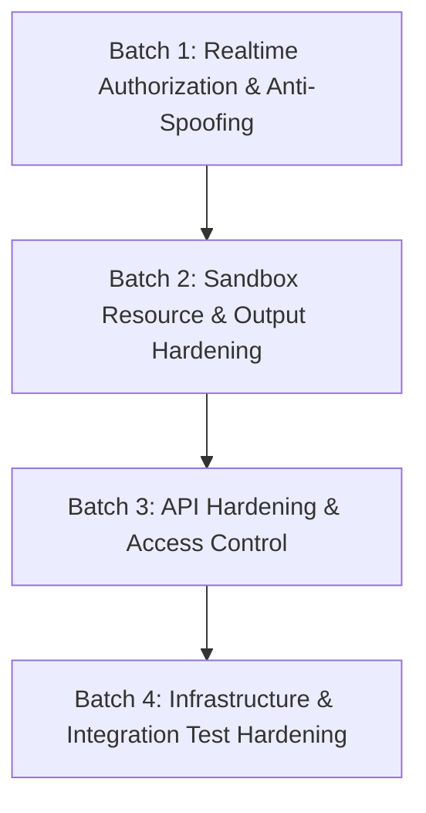

# CodeCollab Security Audit Report (M0.9)

**Date:** October 11, 2026  
**Auditor:** Antigravity AI Security Pair Programmer  
**Branch:** `feature/security-hardening`  
**Scope:** Full-stack source audit of Authentication, Realtime Authorization, Docker Execution Sandbox, API & Infrastructure Configuration, and Verification Quality.  
**Mode:** Audit-only (No application changes made in this phase).

---

## A. Executive Summary

CodeCollab has established a solid architectural foundation with several genuine defensive controls implemented in milestones M0.5 through M0.8. These include:
- Ephemeral Docker execution containers running as a non-privileged `sandbox` user with memory, swap, PID, and CPU limits.
- Network isolation disabled (`NetworkMode: 'none'`) during code execution.
- Bcrypt password hashing (`saltRounds = 10`) without plaintext persistence.
- JWT-based authentication for HTTP routes and initial Socket.IO connection handshakes.
- Driver-only authorization for collaborative editor alterations (`editor:change`) and code execution triggers (`POST /api/execute`).
- Real-time room isolation gates for editor synchronization and room member lists.

However, a thorough evidence-based audit of the live codebase reveals **critical and high-severity security exposures** that prevent the application from being considered secure or safe for public exposure:

1. **Realtime Cross-Room Message Injection & User Spoofing (`SEC-CHAT-01`, `SEC-REALTIME-02`):**  
   The real-time chat, presence, and typing subsystems (`chat.js`, `presence.js`, `typing.js`) perform **zero room membership checks** and **zero user identity verification**. Any connected Socket.IO client can emit events into any arbitrary room ID, forging the sender name, user ID, and message contents.

2. **Unbounded Execution Memory and Timeout Overrides (`SEC-EXEC-01`):**  
   While `sandboxConfig.js` declares conservative limits (5s timeout, 256MB memory), `executionService.js` and `executeCode.js` accept client-supplied `timeout` and `memory` parameters without any upper bound, allowing callers to spawn containers with arbitrary multi-gigabyte memory allocations and multi-hour execution limits.

3. **Unbounded Stdout/Stderr Buffer Memory Consumption (`SEC-EXEC-02`):**  
   The Dockerode output streams in `executor.js` buffer stdout and stderr strings indefinitely without a maximum size cap. A simple looping print statement inside user code can stream hundreds of megabytes of text into the Node.js process heap, triggering an Out-Of-Memory (OOM) crash of the entire backend.

4. **Missing Container Hardening Options (`SEC-EXEC-03`):**  
   Runner containers are created without `ReadonlyRootfs: true`, without dropping Linux capabilities (`CapDrop: ['ALL']`), and without `no-new-privileges:true`. Inside the container, user code runs as user `sandbox`, who owns `/app/runner.py` and `/app` with full write permissions.

5. **Test Hook Leaking into Production Logic & Soft Authorization Fallback (`SEC-ROOM-01`):**  
   `realtime/server/rooms.js` inspects `Room.findOne.mock` (a Jest test artifact) to determine whether the database is configured. If database environment variables are omitted in non-production environments, room authorization fails open rather than failing closed, permitting unauthenticated socket joins.

6. **Infrastructure Exposure & Hardcoded Secrets (`SEC-INFRA-01`):**  
   `docker-compose.yml` hardcodes `JWT_SECRET=dev_secret_key_12345` and exposes MongoDB (port 27017) and Redis (port 6379) directly to host network interfaces without passwords. Furthermore, `backend/Dockerfile` and `frontend/Dockerfile` do not exist, making `docker-compose up` unrunnable.

7. **Private Room Bypass (`SEC-ROOM-02`):**  
   The room model defines `isPrivate: Boolean`, but `joinRoom` in `roomService.js` ignores this flag entirely, allowing any authenticated user who discovers or guesses a room slug to join without authorization.

The current implementation is **suitable for controlled local development only**. It is **not ready for invite-only staging or public deployment** until the prioritized remediation batches below are implemented and verified.

---

## B. Findings Table

The table below catalogs all findings identified during source inspection. Findings are categorized into **Confirmed Vulnerabilities** (reproducible logic/configuration flaws verified in code) and **Potential Risks / Architectural Gaps** (configuration deficiencies or unmitigated edge cases).

| ID | Severity | Category | Component | File Path & Lines | Realistic Scenario | Recommended Mitigation | Tests Needed | Status |
| :--- | :--- | :--- | :--- | :--- | :--- | :--- | :--- | :--- |
| **SEC-CHAT-01** | **High** | Confirmed Vulnerability | Realtime Chat | [`realtime/server/chat.js`](file:///d:/AWT_CodeCollab/realtime/server/chat.js) | Any connected socket emits `chat:message_send` with a foreign `roomId` and spoofed `message.user`. Cross-room members receive malicious or spoofed messages. | Require socket room membership check (`socket.rooms.has(roomId)`). Bind sender metadata strictly to `socket.data.roomVerifiedUsers` or verified JWT. Limit message text length. | Integration test asserting non-member socket cannot emit chat into a room; test asserting spoofed client payload is replaced with verified identity. | **RESOLVED (Batch 1)** |
| **SEC-REALTIME-02** | **Medium** | Confirmed Vulnerability | Realtime Presence & Typing | [`realtime/server/presence.js`](file:///d:/AWT_CodeCollab/realtime/server/presence.js), [`realtime/server/typing.js`](file:///d:/AWT_CodeCollab/realtime/server/typing.js) | Attacker emits `typing:start` or `presence:status` with arbitrary `roomId` and fake user identity, injecting phantom activity into foreign rooms. | Verify room membership before relaying; extract user identity from verified socket session instead of client payload. | Test rejecting unjoined socket typing/presence emissions. | **RESOLVED (Batch 1)** |
| **SEC-ROOM-01** | **High** | Confirmed Vulnerability | Realtime Room Authorization | [`realtime/server/rooms.js`](file:///d:/AWT_CodeCollab/realtime/server/rooms.js) | In environments where `MONGO_URI` is unset and `NODE_ENV !== 'production'`, `isDbConfigured` evaluates to `false`. Database authorization is skipped entirely, admitting unauthenticated sockets with spoofed display names. Leaks test mock check `Room.findOne.mock`. | Remove test mock condition `Room.findOne.mock`. Default to strict fail-closed authorization. Reject unauthenticated joins unconditionally. | Test running `room:join` with DB disconnected / unset in non-production; verify connection is rejected with 401/403 rather than admitted. | **RESOLVED (Batch 1)** |
| **SEC-EXEC-01** | **High** | Confirmed Vulnerability | Execution Engine / Sandbox | [`backend/src/services/executionService.js:119-129`](file:///d:/AWT_CodeCollab/backend/src/services/executionService.js#L119-L129), [`execution/engine/executeCode.js:19`](file:///d:/AWT_CodeCollab/execution/engine/executeCode.js#L19), [`execution/engine/executor.js:84, 101-102`](file:///d:/AWT_CodeCollab/execution/engine/executor.js#L84-L102) | A malicious driver passes `{ timeout: 3600000, memory: "32g" }`. Container runs with 32GB RAM and 1-hour timeout, exhausting host memory and tying up runner concurrency. | Impose strict hard upper bounds: clamp `timeout` (max 10000ms) and `memory` (max 256m or 512m). Disallow unbounded client overrides. | Unit tests validating that requests exceeding limits are clamped or rejected with HTTP 400. | **RESOLVED (Batch 2)** |
| **SEC-EXEC-02** | **High** | Confirmed Vulnerability | Execution Engine / Memory | [`execution/engine/executor.js:119-129`](file:///d:/AWT_CodeCollab/execution/engine/executor.js#L119-L129) | Submitted Python code executes `while True: print("A"*100000)`. Docker demuxed stream concatenates hundreds of megabytes into Node.js memory buffer, crashing the backend with process OOM. | Impose a hard buffer cap (e.g., 64KB or 128KB). When reached, truncate, set a truncation flag, destroy streams, and terminate container. | Test running high-output Python script; verify output string length is capped at limit and backend memory remains flat. | **RESOLVED (Batch 2)** |
| **SEC-EXEC-03** | **High** | Potential Risk | Execution Engine / Sandbox | [`execution/engine/executor.js:100-106`](file:///d:/AWT_CodeCollab/execution/engine/executor.js#L100-L106), [`execution/runners/python/Dockerfile:8-17`](file:///d:/AWT_CodeCollab/execution/runners/python/Dockerfile#L8-L17) | Container root filesystem is writable (`ReadonlyRootfs` omitted); Linux capabilities not dropped (`CapDrop: ['ALL']` omitted); `no-new-privileges` omitted. Inside container, user `sandbox` owns and can write to `/app/runner.py`. | Add `ReadonlyRootfs: true`, mount `Tmpfs: { '/tmp': 'rw,noexec,nosuid,size=32m' }`, add `CapDrop: ['ALL']`, add `SecurityOpt: ['no-new-privileges:true']`, and make `/app` read-only (`chmod -R 555 /app`). | Verify container configuration via Dockerode inspections in unit test. | **RESOLVED (Batch 2)** |
| **SEC-EXEC-04** | **Medium** | Confirmed Vulnerability | Execution Engine / Validation | [`backend/src/services/executionService.js:115-117`](file:///d:/AWT_CodeCollab/backend/src/services/executionService.js#L115-L117), [`execution/engine/executor.js:95`](file:///d:/AWT_CodeCollab/execution/engine/executor.js#L95) | User submits code > 2MB. Linux `ARG_MAX` causes `docker.createContainer` with `Cmd: ['--code', code]` to fail with `E2BIG`. Huge string payloads also overload WebSocket sync. | Validate `code.length <= 65536` (64KB max) in `executionService.js` and `editorSync.js`. Pass code via stdin or mounted file if larger inputs are required. | Test submitting 100KB code string returning HTTP 400 validation error. | **RESOLVED (Batch 2)** |
| **SEC-EXEC-05** | **Medium** | Potential Risk | Execution Queue / Redis | [`execution/engine/queue.js:157-180`](file:///d:/AWT_CodeCollab/execution/engine/queue.js#L157-L180) | Attacker floods `/api/execute`. BullMQ queue has no backlog limit, storing thousands of jobs in Redis memory and stalling execution for all users. | Check `await queue.getWaitingCount()` before enqueueing. If backlog exceeds 25 jobs, reject with HTTP 429/503 "Execution queue is at capacity". | Test verifying queue rejection when backlog limit is reached. | **RESOLVED (Batch 2)** |
| **SEC-AUTH-01** | **Medium** | Potential Risk | Backend / Auth Config | [`backend/src/middleware/auth.js:3-12`](file:///d:/AWT_CodeCollab/backend/src/middleware/auth.js#L3-L12), [`infrastructure/docker-compose.yml:11`](file:///d:/AWT_CodeCollab/infrastructure/docker-compose.yml#L11) | Fallback secret `'dev_secret_key_12345'` is used whenever `NODE_ENV !== 'production'`. In `docker-compose.yml`, this dev secret is hardcoded directly. Any attacker can forge valid admin JWTs. | Reject startup if `JWT_SECRET` is unset or matches known default keys in staging/production. Do not hardcode secret in compose file. | Test that backend throws on startup if `JWT_SECRET` is unset or matches insecure default in non-local environments. | Open (Batch 4) |
| **SEC-AUTH-02** | **Low** | Confirmed Vulnerability | Backend / Auth Service | [`backend/src/services/authService.js:61-69, 128-138`](file:///d:/AWT_CodeCollab/backend/src/services/authService.js#L61-L69) | Registration explicitly states whether "Username is already taken" vs "An account with this email already exists". Login has measurable timing discrepancy (fast on missing user, slow bcrypt on existing user). | Unify registration duplicate error message ("Username or email is already registered"). Perform dummy bcrypt comparison on invalid user lookups to mitigate timing attacks. | Benchmark response latency on existing vs non-existing user login. | **RESOLVED (Batch 3)** |
| **SEC-AUTH-03** | **Medium** | Confirmed Vulnerability | Backend / Driver Auth | [`backend/src/services/executionService.js`](file:///d:/AWT_CodeCollab/backend/src/services/executionService.js) | `verifyDriverPermission` passes if `nameMatch` is true (`driverUsername === reqUsername`), even if `idMatch` is false. User display names are mutable or not guaranteed unique across scopes. | Restrict authorization strictly to immutable user IDs (`idMatch`). Remove `nameMatch` fallback entirely. | Test where driver user ID differs from request user ID but username matches; verify access is denied with HTTP 403. | **RESOLVED (Batch 1)** |
| **SEC-ROOM-02** | **Medium** | Confirmed Vulnerability | Backend / Room Service | [`backend/src/services/roomService.js:208-255`](file:///d:/AWT_CodeCollab/backend/src/services/roomService.js#L208-L255) | `Room.isPrivate` flag is accepted on creation but completely ignored during `joinRoom`. Any authenticated user guessing a room slug joins private rooms directly. | Enforce privacy check: if `room.isPrivate`, require an invitation code, room password, or owner approval before adding membership. | Test attempting to join a private room without authorization credentials; assert rejection. | **RESOLVED (Batch 3)** |
| **SEC-INFRA-01** | **High** | Confirmed Vulnerability | Infrastructure / Docker Compose | [`infrastructure/docker-compose.yml:4-38`](file:///d:/AWT_CodeCollab/infrastructure/docker-compose.yml#L4-L38) | MongoDB (27017) and Redis (6379) ports are published to host network (`0.0.0.0`) without passwords. `backend/Dockerfile` and `frontend/Dockerfile` are missing, causing `docker-compose up` to fail immediately. | Bind DB ports to `127.0.0.1` only. Require passwords for Mongo and Redis. Create standard multi-stage Dockerfiles for backend and frontend. | Verify compose build and port binding isolation. | Open (Batch 4) |
| **SEC-INFRA-02** | **High** | Potential Risk | Infrastructure / Architecture | [`backend/package.json:15`](file:///d:/AWT_CodeCollab/backend/package.json#L15), [`execution/engine/executor.js:6-12`](file:///d:/AWT_CodeCollab/execution/engine/executor.js#L6-L12) | Containerizing the backend requires mounting the host Docker socket (`/var/run/docker.sock`). Any backend compromise grants root-equivalent control over the host Docker daemon. | Isolate execution worker into a dedicated runner service; use rootless Docker or gVisor/Firecracker microVM isolation rather than exposing host Docker daemon. | Threat model validation of backend container privilege boundaries. | Open (Batch 4) |
| **SEC-API-01** | **Medium** | Potential Risk | Backend / API Protection | [`backend/src/routes/auth.js:16, 23`](file:///d:/AWT_CodeCollab/backend/src/routes/auth.js#L16), [`backend/src/routes/execute.js:12`](file:///d:/AWT_CodeCollab/backend/src/routes/execute.js#L12) | No rate limiting middleware on `/api/auth/login`, `/api/auth/register`, or `/api/execute`. Susceptible to brute-force credential stuffing and execution spam DoS. | Add `express-rate-limit` (e.g., 5 attempts/min for login; 20 requests/min for execution). | Integration test asserting HTTP 429 after exceeding request limit. | **RESOLVED (Batch 3)** |
| **SEC-API-02** | **Low** | Potential Risk | Backend / Express Config | [`backend/src/index.js:24-29, 43-53`](file:///d:/AWT_CodeCollab/backend/src/index.js#L24-L29) | No `helmet` security headers configured. No 4-argument global error handler in Express; unhandled exceptions may return stack traces. | Install and configure `helmet()`. Add global error handler returning sanitized JSON error envelopes without stack traces. | Inspect HTTP response headers for `Content-Security-Policy` and `X-Frame-Options`. | **RESOLVED (Batch 3)** |
| **SEC-TEST-01** | **Medium** | Methodological Gap | Frontend Testing | [`testing/frontend/*.test.js`](file:///d:/AWT_CodeCollab/testing/frontend/) | Frontend test suites do not import or exercise actual TypeScript files or React components. They test duplicate mock functions written inside test files with mocked Axios. | Introduce true component integration tests using React Testing Library or Vitest against actual UI components and services. | Test actual `LoginPage`, `AuthContext`, and `Terminal` rendering and behavior. |
| **SEC-DEP-01** | **Low** | Potential Risk | Dependencies | [`package-lock.json`](file:///d:/AWT_CodeCollab/package-lock.json) | `npm audit` reports 38 vulnerabilities (31 high, 7 moderate) in dev dependencies and transitive packages (dompurify, source-map-js, sprintf-js, micromatch). | Update vulnerable dependencies during regular maintenance following non-breaking regression testing. | Re-run `npm audit` to verify resolution. |

---

## C. Existing Protections (Verified Working)

The following security controls are genuinely implemented and verified by automated tests:

1. **Ephemeral Container Lifecycle & Cleanup:**
   - In [`execution/engine/executor.js:192-200`](file:///d:/AWT_CodeCollab/execution/engine/executor.js#L192-L200), `runInSandbox` utilizes a `finally` block to force-remove containers (`container.remove({ force: true })`).
   - Timed-out containers are killed via `container.kill()` before removal.
   - Verified via `testing/execution/execution.test.js`.

2. **Network Isolation in Sandbox:**
   - In [`execution/engine/executor.js:104`](file:///d:/AWT_CodeCollab/execution/engine/executor.js#L104), `HostConfig.NetworkMode` is set to `'none'` when `network: false` (the default). Containerized user code cannot establish outbound connections or scan the local subnet.

3. **PID and Resource Limits:**
   - `HostConfig.PidsLimit: 64` prevents fork bombs inside the container.
   - `HostConfig.MemorySwap: memoryBytes` prevents swap thrashing on the host machine.
   - `HostConfig.NanoCPUs: nanoCPUs` enforces CPU quotas.

4. **Non-Root Execution in Python Runner:**
   - In [`execution/runners/python/Dockerfile:8, 17`](file:///d:/AWT_CodeCollab/execution/runners/python/Dockerfile#L8-L17) and [`execution/engine/executor.js:99`](file:///d:/AWT_CodeCollab/execution/engine/executor.js#L99), containers execute under unprivileged user `sandbox` (UID 1000).

5. **No Shell Command Concatenation / No Direct Shell Injection:**
   - Docker container execution uses `Cmd: ['--code', code]` without passing through `/bin/sh -c`.
   - Python runner script invokes `subprocess.run([sys.executable, "-u", str(submission_path)])` with `shell=False`. Shell meta-characters (`;`, `&&`, `|`) in user code are not evaluated as shell commands.

6. **Bcrypt Password Storage & Zero Hash Leakage:**
   - In [`backend/src/services/authService.js:72-74`](file:///d:/AWT_CodeCollab/backend/src/services/authService.js#L72-L74), passwords are salted and hashed with `bcrypt.genSalt(10)`.
   - Passwords and `passwordHash` are excluded from API responses and JWT claims.
   - Verified via `testing/backend/auth.test.js`.

7. **Driver-Only Code Editing and Execution Authorization:**
   - In [`realtime/server/editorSync.js:51-54`](file:///d:/AWT_CodeCollab/realtime/server/editorSync.js#L51-L54), `editor:change` is rejected if the socket is not the active driver.
   - In [`backend/src/services/executionService.js:44-50`](file:///d:/AWT_CodeCollab/backend/src/services/executionService.js#L44-L50), `POST /api/execute` verifies the caller against the active driver session.
   - Verified via `testing/realtime/editor_sync.test.js` and `testing/backend/execute.test.js`.

8. **Fail-Closed Realtime Room Authorization (When DB Configured):**
   - In [`realtime/server/rooms.js:48-104`](file:///d:/AWT_CodeCollab/realtime/server/rooms.js#L48-L104), unauthenticated sockets and non-member users are rejected before `socket.join(roomId)` is called.
   - Database lookup errors fail closed with `{ ok: false, error: 'Database error occurred during room authorization' }`.
   - Verified via `testing/realtime/room_persistence.test.js`.

---

## D. Verification Summary

All test suites and build checks were executed on the current branch (`feature/security-hardening`).

### 1. Test Runs

| Test Command | Test Suite Target | Suites Passed | Tests Passed | Tests Failed | Execution Time | Notes |
| :--- | :--- | :--- | :--- | :--- | :--- | :--- |
| `npm run test:backend` | `testing/backend/` | 3 / 3 | 48 / 48 | 0 | ~3.9s | Exercises `execute.test.js` (12), `auth.test.js` (19), and `rooms.test.js` (17). |
| `npm run test:realtime` | `testing/realtime/` | 5 / 5 | 24 / 24 | 0 | ~1.8s | Exercises `editor_sync` (12), `driver` (7), `room_persistence` (2), `sockets` (2), `presence_activity` (1). Note: 1 test added in Batch 2 for max code size enforcement. |
| `npm run test:execution` | `testing/execution/` | 3 / 3 | 36 / 36 | 0 | ~10.5s | Exercises Dockerode `execution.test.js` (16), Redis BullMQ `queue.test.js` (11), Python `python_runner.test.js` (9). |
| `npm run test:frontend` | `testing/frontend/` | 3 / 3 | 32 / 32 | 0 | ~0.6s | Exercises simulated `auth_frontend` (11), `execution_frontend` (11), `room_frontend` (10). |
| `npx jest testing/security/` | `testing/security/` | 3 / 3 | 54 / 54 | 0 | ~14.6s | Dedicated security suites: `remediation_batch1.test.js` (16), `remediation_batch2.test.js` (18), `remediation_batch3.test.js` (20). |
| **Total Test Execution** | **Entire Test Suite** | **17 / 17** | **194 / 194** | **0** | **~24s** | **All 194 automated tests passed across all 17 test suites.** |

#### Test Count Reconciliation Analysis:
- **Baseline (pre-hardening):** 139 tests across 14 test suites (Backend: 48, Realtime: 23, Execution: 36, Frontend: 32).
- **Batch 1 Addition:** +1 test suite (`testing/security/remediation_batch1.test.js`) with 16 tests. Cumulative total: 155 tests across 15 suites.
- **Batch 2 Addition:** +1 test suite (`testing/security/remediation_batch2.test.js`) with 18 tests, and +1 regression test added to `testing/realtime/editor_sync.test.js` to enforce the 64 KiB code sync limit (realtime total increased from 23 to 24 tests). Arithmetic: `139 + 16 + 18 + 1 = 174` tests across 16 suites.
- **Batch 3 Addition:** +1 test suite (`testing/security/remediation_batch3.test.js`) with 20 tests. Arithmetic: `174 + 20 = 194` tests across 17 suites.
- **Verification:** Fresh command execution (`npm test -- --runInBand --forceExit`) confirms exactly 17 test suites and 194 tests passing with 0 failures in 23.9s.

### 2. Frontend Production Build Check

- **Command:** `npm run build` (`npm run build --workspace frontend` -> `tsc && vite build`)
- **Result:** **Success (Exit code 0)**
- **Modules Transformed:** 121 modules
- **Output Artifacts:** `dist/index.html` (0.32 kB), `dist/assets/index-biPTUhOV.js` (291.73 kB)
- **Duration:** 73ms

### 3. Dependency Security Audit

- **Command:** `npm audit`
- **Result:** 38 vulnerabilities reported (31 high, 7 moderate).
  - `dompurify` (moderate, via `monaco-editor`)
  - `source-map-js` (high, via vite/postcss build tooling)
  - `micromatch` / `sprintf-js` (high/moderate, via `jest` dev-dependencies)

### 4. Integration Coverage: Mocked vs. Real Services

| Service / Boundary | Status During Verification | Notes & Gaps |
| :--- | :--- | :--- |
| **Docker Engine** | **Real Service** | Interacted with live Docker daemon. Real container spawned, executed, hardened (ReadonlyRootfs, CapDrop ALL, memory clamped, output truncated), and cleaned up in `execution.test.js`, `queue.test.js`, and `remediation_batch2.test.js`. |
| **Redis** | **Real Service** | Connected to live container `infrastructure-redis-1` on port 6379. Enqueued, processed, bounded (max 25 jobs), and validated BullMQ jobs. |
| **MongoDB** | **100% Mocked** | No live MongoDB instance was active on port 27017. All backend, realtime, and security tests mocked Mongoose queries via `jest.spyOn(User, ...)` and `jest.spyOn(Room, ...)`. Zero tests run against a real MongoDB instance. |
| **Frontend UI Components** | **100% Mocked** | `testing/frontend/` does not mount React components or import TS files. Tests execute simulated JavaScript helper functions with mocked Axios. |
| **Security Tests** | **Real Suites (54 Tests)** | Directory `testing/security/` contains 3 comprehensive regression suites covering Batches 1, 2, and 3 (`remediation_batch1.test.js`, `remediation_batch2.test.js`, `remediation_batch3.test.js`). |

---

## E. Prioritized Remediation Plan

To address these vulnerabilities safely without destabilizing working features, remediations are divided into four sequential, dependency-aware batches:

### Batch 1: Realtime Authorization & Anti-Spoofing (Immediate Priority) — [STATUS: COMPLETED & VERIFIED]
*Target: Stop cross-room event injection, user spoofing, and fail-open fallbacks.*
1. **Chat Room Isolation & Verification (`SEC-CHAT-01`):**  
   - Implemented in [`realtime/server/chat.js`](file:///d:/AWT_CodeCollab/realtime/server/chat.js). Checks both `socket.rooms.has(roomId)` and `socket.data.roomMemberships.has(roomId)`.
   - Derives sender identity strictly from server verified state (`roomVerifiedUsers` / `verifiedUser`). Discards client-provided user claims.
   - Enforces a 2,000 character maximum message length.
2. **Presence & Typing Room Isolation (`SEC-REALTIME-02`):**  
   - Implemented in [`realtime/server/presence.js`](file:///d:/AWT_CodeCollab/realtime/server/presence.js) and [`realtime/server/typing.js`](file:///d:/AWT_CodeCollab/realtime/server/typing.js). Checks room membership and verifies socket identity prior to event relay.
   - Whitelists status values and derives broadcast metadata strictly from server state.
3. **Remove Test Mock & Enforce Strict Fail-Closed (`SEC-ROOM-01`):**  
   - Completely removed `Room.findOne.mock` and `isDbConfigured` bypass from [`realtime/server/rooms.js`](file:///d:/AWT_CodeCollab/realtime/server/rooms.js).
   - Unconditionally fails closed if database is unavailable, error occurs, room does not exist, or socket lacks valid authentication.
4. **Driver Verification Hardening (`SEC-AUTH-03`):**  
   - Removed `nameMatch` fallback in [`backend/src/services/executionService.js`](file:///d:/AWT_CodeCollab/backend/src/services/executionService.js).
   - Strictly enforces matching immutable user IDs (`driverUserId === reqUserId`). Rejects execution if IDs differ even when usernames match.
5. **Verification & Regression Tests:**
   - 16 dedicated security integration tests added and passing in [`testing/security/remediation_batch1.test.js`](file:///d:/AWT_CodeCollab/testing/security/remediation_batch1.test.js).
   - 100% test suite passing across realtime (23/23), backend (48/48), execution (36/36), frontend (32/32), and security suites (total 155/155 tests).

### Batch 2: Execution Sandbox & Resource Hardening — [STATUS: COMPLETED & VERIFIED]
*Target: Prevent Node.js process crashes, container escapes, and host resource exhaustion.*
1. **Enforce Strict Resource Ceilings (`SEC-EXEC-01`):**  
   - Authoritative policy constants in [`execution/engine/sandboxConfig.js`](file:///d:/AWT_CodeCollab/execution/engine/sandboxConfig.js): default timeout 5,000ms, max timeout 10,000ms, max memory 256 MiB, CPU 0.5, PID limit 64, network disabled.
   - Strict validation in [`backend/src/services/executionService.js`](file:///d:/AWT_CodeCollab/backend/src/services/executionService.js): rejects client overrides exceeding 10,000ms timeout or 256 MiB memory with HTTP 400.
   - Defensive engine clamping in [`execution/engine/executor.js`](file:///d:/AWT_CodeCollab/execution/engine/executor.js) ensures internal callers cannot bypass limits.
   - Safe memory parsing via `parseMemoryToBytes` safely handles numeric and string formats while rejecting negative, zero, or malformed inputs.
2. **Stdout/Stderr Stream Buffer Limits (`SEC-EXEC-02`):**  
   - Enforced 64 KiB buffer cap per stream in [`execution/engine/executor.js`](file:///d:/AWT_CodeCollab/execution/engine/executor.js).
   - UTF-8 byte tracking prevents multi-byte overflow. Immediately calls `container.kill()`, caps stored output with `\n[Output truncated: exceeded 64KB limit]`, safely drains streams to avoid backpressure hangs, and ensures ephemeral container removal.
   - Differentiates output termination as `status: 'failed'`, exit code 137, rather than misclassifying as timeout.
3. **Container Security Flags (`SEC-EXEC-03`):**  
   - Docker HostConfig hardened with `ReadonlyRootfs: true`, `CapDrop: ['ALL']`, `SecurityOpt: ['no-new-privileges:true']`, and `Tmpfs: { '/tmp': 'rw,noexec,nosuid,size=32m' }`.
   - Updated [`execution/runners/python/Dockerfile`](file:///d:/AWT_CodeCollab/execution/runners/python/Dockerfile): sets `PYTHONPYCACHEPREFIX=/tmp` and marks `/app` read-and-execute-only (`chmod -R 555 /app`) owned by `root:root`. Rebuilt and tested live runner image.
4. **Max Code Submission Limit (`SEC-EXEC-04`):**  
   - Enforced 64 KiB UTF-8 byte limit across `backend/src/services/executionService.js` (HTTP 400), `execution/engine/executeCode.js` (defensive check), and `realtime/server/editorSync.js` (rejects `editor:change` without broadcasting to room peers).
5. **Execution Queue Backlog Cap (`SEC-EXEC-05`):**  
   - Configured max backlog capacity of 25 waiting jobs (`MAX_WAITING_JOBS = 25`) in `queue.js` and `sandboxConfig.js`.
   - Admission control in `queue.add()` and `executeCodeService`: rejects excess jobs with HTTP 429 (`QUEUE_CAPACITY_EXCEEDED`) without crashing workers or disrupting FIFO execution.
6. **Verification & Regression Tests:**
   - 18 dedicated security regression tests added and passing in [`testing/security/remediation_batch2.test.js`](file:///d:/AWT_CodeCollab/testing/security/remediation_batch2.test.js).
   - Full test suite passes: 174 / 174 automated tests passing across all 16 test suites (execution, backend, realtime, frontend, and security).
   - Frontend production build verified: `npm run build` succeeds (121 modules transformed, 0 errors).

### Batch 3: API Hardening & Access Control — [STATUS: COMPLETED & VERIFIED]
*Target: Protect HTTP endpoints against brute force, enumeration, private room bypass, and information leakage.*
1. **Private Room Protection & Cryptographic Invitations (`SEC-ROOM-02`):**  
   - Privacy enforcement: `roomService.joinRoom` checks `room.isPrivate`. Non-members cannot join a private room by guessing its slug without a valid invite code.
   - Cryptographic invitation tokens: Private rooms generate a 16-character hex token via `crypto.randomBytes(8).toString('hex')`.
   - Timing-safe verification: Uses `crypto.timingSafeEqual` in `verifyInviteCode` to mitigate timing side-channel attacks during code validation.
   - Confidentiality: Room details and list queries withhold `inviteCode` from responses. Only the creator receives the initial token on creation, or the room owner via dedicated endpoints.
   - Owner management endpoints: Added `GET /api/rooms/:roomId/invite` and `POST /api/rooms/:roomId/invite/rotate` for authorized room owners; non-owners are rejected with HTTP 403 Forbidden.
   - Compatibility: Public rooms continue to allow joining without an invite code. Room owners and existing authorized members retain seamless, idempotent access.
   - Outstanding Review Item & Non-Production Limitation: The current implementation generates 8 random bytes (64 bits of entropy) stored in plaintext on the Room document without an expiration timestamp (TTL), scoped access, or single-use limits. While this successfully eliminates the open-join vulnerability (`SEC-ROOM-02`) and provides timing-safe verification for milestone M0.9, it must NOT be represented as production-ready. Production hardening will require higher entropy (>= 128 bits), cryptographic hashing at rest (e.g., SHA-256), expiration dates, and revocable/single-use tokens.
2. **Route Rate Limiting (`SEC-API-01`):**  
   - Applied independent rate limiters via `express-rate-limit`:
     - `POST /api/auth/login`: 5 attempts per IP per minute (configurable via `RATE_LIMIT_LOGIN_MAX`).
     - `POST /api/auth/register`: 5 attempts per IP per minute (configurable via `RATE_LIMIT_REGISTER_MAX`).
     - `POST /api/execute`: 20 requests per IP per minute (configurable via `RATE_LIMIT_EXECUTE_MAX`).
   - Standard RFC draft-6/7 headers enabled (`RateLimit-Limit`, `RateLimit-Remaining`, `RateLimit-Reset`); legacy headers disabled.
   - Anti-spoofing protection: Express `trust proxy` is disabled by default; requests are keyed strictly by socket remote IP (`req.ip`), preventing attackers from bypassing limits via spoofed `X-Forwarded-For` headers.
   - Response envelope: Returns HTTP 429 `{ ok: false, error: ... }` directly without conversion to HTTP 500.
   - Architecture note: Uses in-memory `MemoryStore` per Node.js process. In multi-instance clusters, a distributed Redis store (`rate-limit-redis`) would be required.
3. **Security Headers & Sanitized Global Error Handling (`SEC-API-02`):**  
   - Mounted `helmet` before route handling with `contentSecurityPolicy: false` and `crossOriginResourcePolicy: { policy: 'cross-origin' }`, setting `X-Content-Type-Options: nosniff`, `X-Frame-Options: SAMEORIGIN`, `X-DNS-Prefetch-Control: off`, and stripping `X-Powered-By`.
   - Added 4-argument Express error handling middleware (`globalErrorHandler`) after all routes.
   - Preserves intentional 4xx client statuses (400, 401, 403, 404, 409, 429).
   - Sanitizes unexpected internal 500 exceptions into a uniform `{ ok: false, error: 'Internal server error' }`, suppressing stack traces, file paths, and database query details. Server logs diagnostic errors with credentials redacted.
4. **Account Enumeration & Auth Timing Mitigation (`SEC-AUTH-02`):**  
   - Unified duplicate registration error response: Both existing username and existing email return generic HTTP 409 Conflict with message `"Username or email is already registered"`.
   - Race condition protection: MongoDB unique index duplicate key error (`code: 11000` / `codeName: 'DuplicateKey'`) caught and mapped to the same generic 409 envelope.
   - Authentication timing mitigation: Nonexistent login identity performs a bcrypt comparison against a precomputed module-level dummy hash (`DUMMY_PASSWORD_HASH`) using cost factor 10, equalizing work and mitigating account enumeration via login response latency.
5. **Verification & Regression Tests:**
   - 20 dedicated security integration tests added and passing in [`testing/security/remediation_batch3.test.js`](file:///d:/AWT_CodeCollab/testing/security/remediation_batch3.test.js).
   - Full test suite passes: 194 / 194 automated tests passing across all 17 test suites.
   - Frontend production build verified: `npm run build` succeeds (121 modules transformed, 0 errors).

### Batch 4: Infrastructure & Test Hardening — [STATUS: OPEN]
*Target: Ensure reproducible containerization, secure network defaults, and genuine regression tests.*
1. **Docker Compose Hardening & Application Dockerfiles (`SEC-INFRA-01`):**  
   Bind Redis and Mongo to `127.0.0.1`. Add Dockerfiles for `backend` and `frontend`. Remove hardcoded `JWT_SECRET`.
2. **Dedicated Security Regression Test Suite:**  
   Populate `testing/security/` with tests verifying chat isolation, driver spoofing rejection, execution buffer truncation, and resource clamp enforcement.
3. **Real Frontend Component Integration Tests (`SEC-TEST-01`):**  
   Replace simulated helper test files in `testing/frontend/` with tests mounting actual React components.

---

## F. Release Readiness

| Deployment Tier | Readiness Status | Recommendation & Justification |
| :--- | :--- | :--- |
| **Local Development** | **READY** | Suitable for single-user local development, UI prototyping, and unit test execution where the host and network are trusted. |
| **Invite-Only Staging** | **NOT READY** | **Blocked.** Staging with multiple untrusted users exposes the environment to cross-room chat/presence spoofing (`SEC-CHAT-01`), private room eavesdropping (`SEC-ROOM-02`), and server denial-of-service via unbounded execution output (`SEC-EXEC-02`). Must implement Remediation Batches 1 & 2 before staging deployment. |
| **Public Exposure** | **STRICTLY BLOCKED** | **Severely Unsafe.** Public exposure risks host compromise, container starvation, unrestricted Docker resource abuse, account brute-forcing, and exposed unauthenticated database ports (`SEC-INFRA-01`, `SEC-EXEC-01`, `SEC-EXEC-02`, `SEC-EXEC-03`, `SEC-API-01`). Must complete all 4 remediation batches and real-service integration verification before public launch. |

---
*End of Security Audit Report (M0.9)*
